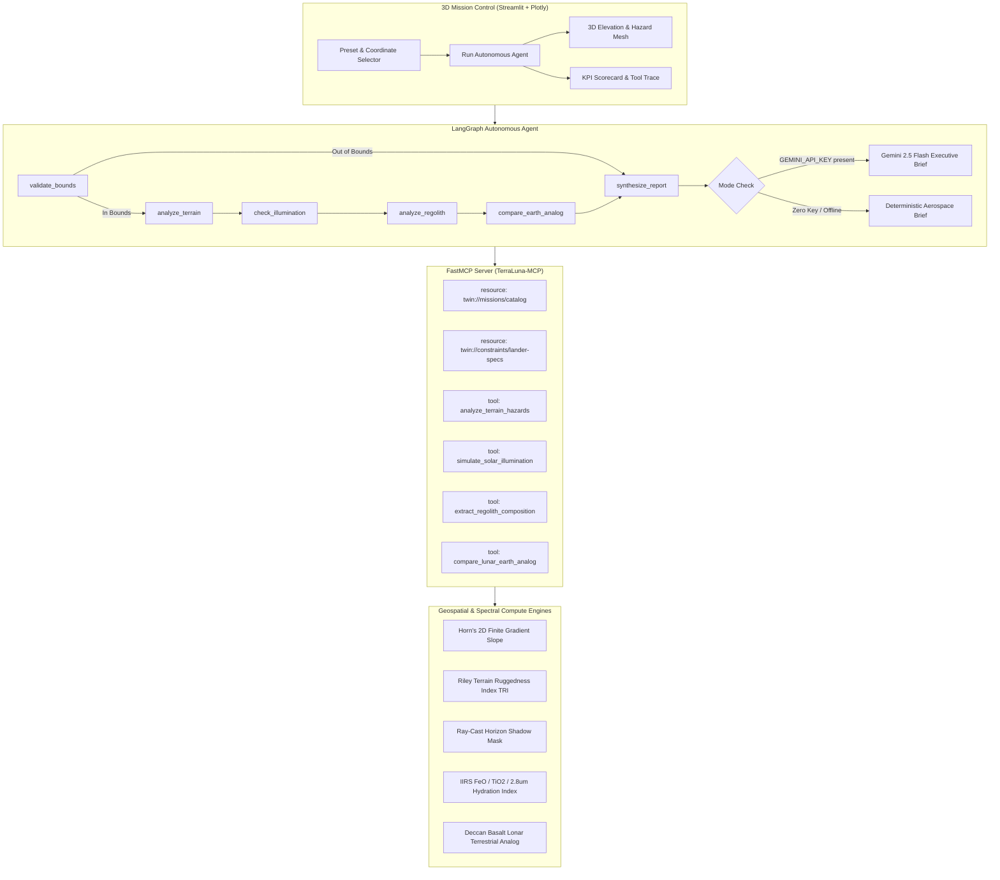

# 🌕 TerraLuna: Autonomous Lunar & Terrestrial Landing-Site Validation

[](https://www.python.org/)
[](https://github.com/jlowin/fastmcp)
[](https://github.com/langchain-ai/langgraph)
[](https://aistudio.google.com/)
[](https://streamlit.io/)
[](evals/test_landing_sites.py)

**TerraLuna** is a production-grade, end-to-end Geospatial Digital Twin and Autonomous AI Agent system designed to validate planetary landing sites for ISRO Chandrayaan-class and NASA Artemis-class lunar landers.

The system connects deterministic raster geospatial math engines via a **Model Context Protocol (MCP)** server to an **Autonomous LangGraph AI Agent** powered by Google Gemini, paired with an interactive **3D Aerospace Mission Control Dashboard** built in Streamlit and Plotly.

---

## 🏛️ System Architecture



---

## 🚀 Key Capabilities

1. **Deterministic FastMCP Server (`mcp_server/server.py`)**:
   - **MCP Resources**:
     - `twin://missions/catalog`: Dynamic JSON index of available Lunar South Pole and Earth Analog datasets, CRS, bounding boxes, and sensor metadata.
     - `twin://constraints/lander-specs`: Authoritative structural tolerances (max 10.0° slope, max 0.45m TRI, min 65.0% illumination).
   - **MCP Prompt**:
     - `landing_site_audit_prompt(site_name, lat, lon)`: Reusable mission-control audit template for flight controllers.
   - **Deterministic MCP Tools**:
     - `analyze_terrain_hazards`: Clips DEM window, calculates Horn's slope using 2D finite gradients, Riley TRI, % unsafe pixels, and produces a downsampled 3D mesh artifact.
     - `simulate_solar_illumination`: Casts reverse rays towards the solar azimuth/elevation vector to compute topographic horizon occlusions, self-shadowing, and permanently shadowed region (PSR) cryogenic hazards.
     - `extract_regolith_composition`: Extracts FeO wt%, TiO2 wt%, and 2.8µm OH/H2O hydration index to classify regolith (e.g., *Highland Anorthosite*, *Mare Basalt*, *Hydrated Cold Trap*).
     - `compare_lunar_earth_analog`: Computes quantitative similarity (0–100%) against Lonar Basalt Meteorite Crater in Maharashtra, India.

2. **Dual-Mode Autonomous LangGraph Agent (`agent/graph.py`)**:
   - **Gemini LLM Mode**: Powered by `ChatGoogleGenerativeAI(model="gemini-2.5-flash")` with your `GEMINI_API_KEY` from [Google AI Studio](https://aistudio.google.com/). Synthesizes flight director briefs.
   - **Offline Deterministic Fallback Mode**: Works **100% offline with zero API keys** if `GEMINI_API_KEY` is omitted, executing the exact LangGraph state machine over deterministic MCP tools and formatting an aerospace engineering brief.

3. **3D Mission Control Web Dashboard (`dashboard/app.py`)**:
   - Interactive 3D terrain surface mesh rendered with Plotly WebGL.
   - Dynamic colormaps: **Elevation (m)**, **Slope Hazard (°)** (red > 10° limit), or **Solar Shadow Mask** (1 = lit, 0 = shadow).
   - 4 Mission KPI Cards: `Mean Slope`, `Sunlit Area %`, `Regolith Type`, `Earth Analog Match %`.
   - Live expandable **MCP Tool Execution Trace** displaying exact millisecond latency, JSON inputs, and JSON outputs.

4. **Synthetic-but-Physically-Realistic GeoTIFF Generator (`scripts/generate_sample_rasters.py`)**:
   - Automatically generates 4 georeferenced rasters (`EPSG:4326`) on first launch:
     - `data/lunar/ch2_tmc2_south_pole_dem.tif`: Chandrayaan-2 TMC-2 / NASA LRO LOLA composite DEM at Lunar South Pole.
     - `data/lunar/ch2_iirs_hydration.tif`: Multi-band FeO, TiO2, and 2.8µm hydration band depth.
     - `data/earth_analog/lonar_crater_dem.tif`: Lonar Basalt Crater DEM (1.8km crater with 510m rim and 450m saline lake).
     - `data/earth_analog/lonar_sentinel2_bands.tif`: Sentinel-2 basaltic iron oxide and clay alteration bands.

---

## 📁 Repository Structure

```text
terraluna-mcp/
├── .env.example                     # API key configuration template
├── .env                             # Local environment configuration
├── requirements.txt                 # Pinned dependencies
├── README.md                        # Complete project documentation
├── data/
│   ├── lunar/
│   │   ├── ch2_tmc2_south_pole_dem.tif  # Lunar South Pole DEM
│   │   └── ch2_iirs_hydration.tif       # 3-band spectral regolith raster
│   ├── earth_analog/
│   │   ├── lonar_crater_dem.tif         # Lonar Crater basalt DEM
│   │   └── lonar_sentinel2_bands.tif    # 3-band Sentinel-2 mineral proxy
│   └── artifacts/                       # Generated 3D mesh & overlay JSONs
├── scripts/
│   └── generate_sample_rasters.py       # Deterministic GeoTIFF generator
├── mcp_server/
│   ├── __init__.py
│   ├── terrain_engine.py                # Horn's slope, TRI, and solar ray-casting
│   ├── spectral_engine.py               # FeO, TiO2, hydration & analog similarity
│   └── server.py                        # FastMCP Server (Resources, Prompts, Tools)
├── agent/
│   ├── __init__.py
│   ├── schemas.py                       # Pydantic v2 schemas & LandingZoneReport
│   └── graph.py                         # LangGraph state machine & Gemini client
├── dashboard/
│   └── app.py                           # Streamlit + Plotly 3D Mission Control
└── evals/
    └── test_landing_sites.py            # Automated pytest verification suite
```

---

## ⚡ Quickstart & Setup Guide

### 1. Prerequisites
- Python 3.11 or Python 3.12
- Git

### 2. Clone and Setup Environment
```bash
# Clone the repository
git clone https://github.com/your-username/terraluna-mcp.git
cd terraluna-mcp

# Create and activate virtual environment
python -m venv .venv

# Windows:
.venv\Scripts\activate
# Linux / macOS:
source .venv/bin/activate

# Install dependencies
pip install -r requirements.txt
```

### 3. Generate Scientific Datasets
Run the sample raster generator (generates all 4 georeferenced GeoTIFFs immediately):
```bash
python scripts/generate_sample_rasters.py
```

### 4. Configure Google Gemini API Key (Optional)
Copy `.env.example` to `.env`:
```bash
cp .env.example .env
```
Open `.env` and add your free Google AI Studio API key:
```ini
GEMINI_API_KEY=AIzaSy...your_actual_key_here
```
> **Note:** If `GEMINI_API_KEY` is left blank, the system automatically runs in **100% Offline Deterministic Fallback Mode**. No external calls or credits required!

---

## 🖥️ Running the Application

### Launch the 3D Mission Control Web Dashboard
```bash
python -m streamlit run dashboard/app.py
```
Open your browser at `http://localhost:8501`.

#### Using the Dashboard:
1. Select a **Mission Target Preset** in the sidebar:
   - **Preset 1 (Safe Ridge)**: Flat landing plateau adjacent to South Pole crater (`lat: -89.494°`, `lon: -0.680°`) -> **APPROVED**.
   - **Preset 2 (Steep Rim)**: 28° crater rim wall (`lat: -89.506°`, `lon: +0.680°`) -> **REJECTED_HAZARD**.
   - **Preset 3 (Earth Analog)**: Lonar Basalt Crater (`lat: 19.976°`, `lon: 76.508°`).
   - **Custom Coordinates**: Test any coordinate within dataset bounds or test out-of-bounds safety refusals.
2. Adjust **Search Footprint Radius**, **Sun Elevation Angle**, or **Max Lander Slope Tolerance**.
3. Click **"Run Autonomous Agent Validation"**.
4. Inspect the interactive 3D terrain surface, change colormaps (**Elevation**, **Slope Hazard**, **Solar Mask**), and review the live MCP step-by-step tool trace.

---

## 🔬 Testing with the Official MCP Inspector

You can inspect and debug the FastMCP server directly using Anthropic/Model Context Protocol's official visual inspector:

```bash
npx @modelcontextprotocol/inspector python mcp_server/server.py
```

In the MCP Inspector UI:
- **Resources**: View and read `twin://missions/catalog` and `twin://constraints/lander-specs`.
- **Prompts**: Render `landing_site_audit_prompt` with custom coordinates.
- **Tools**: Directly execute `analyze_terrain_hazards`, `simulate_solar_illumination`, `extract_regolith_composition`, and `compare_lunar_earth_analog`.

---

## 🧪 Automated Benchmark & Verification Suite

Run the full end-to-end automated test suite:
```bash
python -m pytest -v evals/test_landing_sites.py
```

### Evaluation Matrix:
| Test Case | Scenario | Expected Verdict | Verified Telemetry |
| :--- | :--- | :--- | :--- |
| `test_safe_ridge_approved` | Safe South Polar Ridge | `APPROVED` | Mean slope ~2.89° (<10°), 100% Sunlit, Safety Score = 100.0 |
| `test_steep_crater_rim_rejected` | 28° Impact Crater Rim | `REJECTED_HAZARD` | Mean slope ~29.4° (>10°), 90.9% unsafe pixels, Safety Score = 0.0 |
| `test_out_of_bounds_refusal` | Target outside bounds | `OUT_OF_BOUNDS` | Automated abort engaged, Safety Score = 0.0, zero descent burn |
| `test_earth_analog_lonar_crater` | Lonar Basalt Analog | `APPROVED`/`REJECTED` | Validates Deccan basalt slope profile & Sentinel-2 mineral bands |
| `test_mcp_server_primitives` | FastMCP Architecture | `PASS` | Tests all resources, prompts, and tools via direct Python API |

---

## 🛰️ Dropping in Real ISRO Pradan / NASA PDS Rasters

To replace the synthetic rasters with raw missions GeoTIFFs:
1. Download Level-2 calibrated DEM and Map-projected spectral products from:
   - **ISRO ISSDC / Pradan**: Chandrayaan-2 TMC-2 Stereo DEMs & IIRS Level-2 calibrated radiances.
   - **NASA Planetary Data System (PDS)**: LRO LOLA GDR DEMs (Lunar Orbiter Laser Altimeter).
   - **Bhuvan / USGS**: Cartosat-1 / SRTM DEMs for Earth Analogs.
2. Ensure tiles are in `EPSG:4326` or reproject using GDAL:
   ```bash
   gdalwarp -t_srs EPSG:4326 input_dem.tif data/lunar/ch2_tmc2_south_pole_dem.tif
   ```
3. Update bounding boxes in `DATASET_REGISTRY` in `mcp_server/server.py`. The rest of the pipeline executes without any code changes!

---

## ⚖️ Engineering Assumptions & Formula Reference

- **Horn's 2D Finite Gradient Slope**:
  $$\frac{\partial z}{\partial x} = \text{np.gradient}(z, \Delta x, \text{axis}=1), \quad \frac{\partial z}{\partial y} = \text{np.gradient}(z, \Delta y, \text{axis}=0)$$
  $$\theta_{\text{slope}} = \arctan\left(\sqrt{\left(\frac{\partial z}{\partial x}\right)^2 + \left(\frac{\partial z}{\partial y}\right)^2}\right) \times \frac{180}{\pi}$$
- **Terrain Ruggedness Index (Riley et al. 1999)**:
  $$\text{TRI} = \sqrt{\frac{1}{8}\sum_{i=-1}^{1}\sum_{j=-1}^{1} (z_{y+i, x+j} - z_{y, x})^2} \quad \text{for } (i,j) \neq (0,0)$$
- **Solar Vector & Horizon Ray-Casting**:
  $$\vec{S} = (\sin\theta_{\text{az}}\cos\phi_{\text{el}}, -\cos\theta_{\text{az}}\cos\phi_{\text{el}}, \sin\phi_{\text{el}})$$
  Occlusion occurs when any intermediate terrain height $z_{\text{terrain}}(s) > z_0 + s \cdot \tan(\phi_{\text{el}})$.

---

## 📜 License
MIT License. Built for autonomous planetary exploration research.
